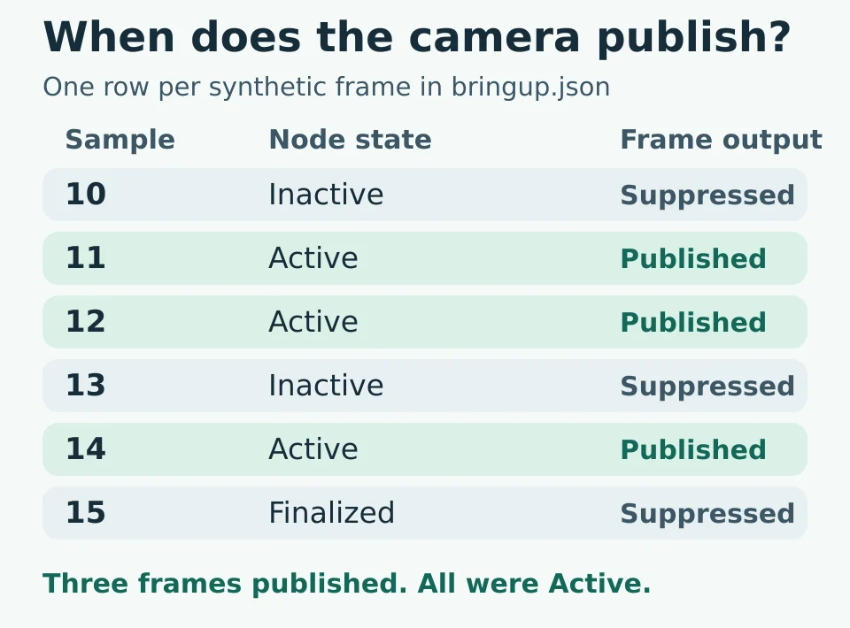
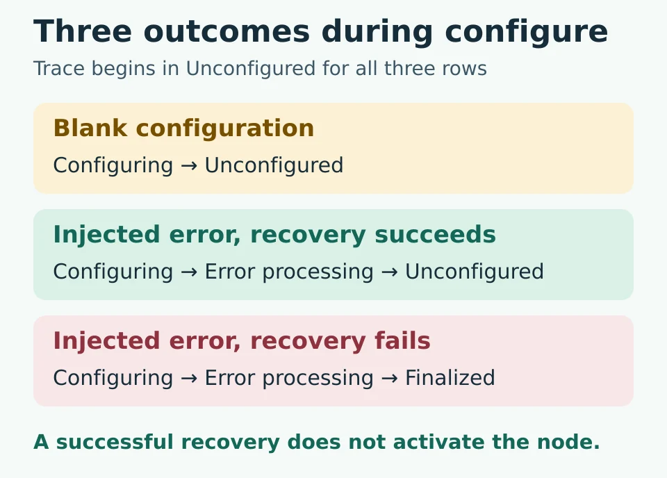

# ROS 2 lifecycle nodes: camera startup replay

Run a small Python model to see what changes when a managed camera node is configured, activated, deactivated, or shut down. The [WIFA Robotics lesson](https://wifarobotics.com/learn/ros-2-lifecycle-nodes/) explains each trace and shows how to compare it with the official ROS 2 demo.

## Run from zero

1. Install [Python](https://www.python.org/downloads/) 3.10 or newer and open a terminal. Check it with `python3 --version` on Linux or macOS. On Windows use `py -3 --version` and substitute `py -3` for `python3` below.
2. Download this repository as a ZIP from **Code → Download ZIP** on GitHub, extract it, and open a terminal in the extracted folder. If Git is already installed, use `git clone https://github.com/williamfarokhzad/wifa-ros-2-lifecycle-nodes.git` then `cd wifa-ros-2-lifecycle-nodes`.
3. Run the examples and tests. No pip install or ROS installation is needed.

```sh
python3 lifecycle_replay.py examples/bringup.json
python3 lifecycle_replay.py examples/recover.json --json
python3 lifecycle_replay.py examples/finalized.json
python3 -m unittest discover -s tests -v
```

| Example | What to look for | Expected ending |
| --- | --- | --- |
| Bringup | Samples 11, 12 and 14 are emitted; 10, 13 and 15 are suppressed | Finalized, 3 published frames |
| Recover | Blank configuration never enters error processing. Injected recovery does, and a new configure is required | Active, 2 published frames with different frame IDs |
| Finalized | Failed recovery ends the instance; the later configure is rejected | Finalized, 0 published frames |

Each JSON row has an `event`. A `configure` row requires a string `frame_id`; optional `inject` can be `none`, `recoverable` or `fatal`. A `frame` requires a nonnegative integer `sample`. All other event names in the shipped examples take no extra fields. Use `--json` for per event state, intermediate states and emitted values. Scenario errors return exit code 2. A rejected transition inside a valid scenario is an expected trace result and does not make the program fail.

**If something goes wrong:** run the terminal from the directory containing `lifecycle_replay.py`, and check the filename and its case. If a sample is suppressed after `configure`, add `activate` before the sample. To change the frame ID while active, first send `deactivate` and `cleanup`. Fix JSON syntax or a bad field before running again.



The project replays JSON events synchronously. It does not use ROS middleware, drivers, motors, real images or timers. It does not simulate discovery, QoS or concurrency and is not a hardware safety gate. Compare the real graph and demo at the [ROS 2 lifecycle package index](https://index.ros.org/p/lifecycle/#jazzy).



The diagram sources are the editable SVG files beside their WebP exports.
